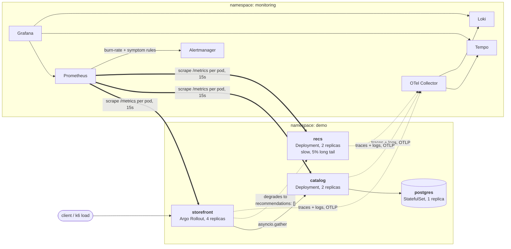

# k8s-slo-platform

[](https://github.com/tani-mani-meow/k8s-slo-platform/actions/workflows/app-ci.yml)
[](https://github.com/tani-mani-meow/k8s-slo-platform/actions/workflows/manifests.yml)
[](https://github.com/tani-mani-meow/k8s-slo-platform/actions/workflows/e2e-kind.yml)
[](LICENSE)

A Kubernetes platform with service level objectives, burn-rate alerting, canary deploys
that abort themselves, and a chaos suite that breaks it on purpose and writes down what
the alerting said and how long recovery took.

**Most infrastructure projects stop at "it deployed". This one starts there.** Every
piece exists to answer one question: when something breaks, does the platform notice,
and how fast does it recover?

→ **[docs/slo-methodology.md](docs/slo-methodology.md)** the burn-rate arithmetic, derived by hand, and the misconfiguration it caught
→ **[evidence/](evidence/README.md)** where the measured recovery times land
→ **[docs/demo-script.md](docs/demo-script.md)** a ten-minute guided tour

```bash
make demo
```

Brings the whole stack up on `kind` on a laptop: three services, Postgres, Argo CD,
Prometheus, Grafana, Loki, Tempo, Argo Rollouts, Chaos Mesh, and a load generator so the
SLOs have real traffic to measure. No cloud account, no cost. Read
[docs/prerequisites.md](docs/prerequisites.md) first, especially if you're on Windows.
There's a WSL2/inotify gotcha in there that will otherwise cost you an hour.

One honest caveat up front: the evidence directory is still empty. Everything that
doesn't need a live cluster is verified here: 83 unit tests, every Kustomize overlay
rendered and schema-checked, Terraform validated, every script and workflow linted. I
haven't run the chaos suite against a real cluster yet, though, so the MTTR table has no
rows. That's next, not a gap I'm trying to hide, and [`evidence/`](evidence/README.md)
says the same thing rather than showing numbers it doesn't have.

---

## What is here

The application itself is small on purpose: three FastAPI services, `storefront` (the
edge, fans out to the other two), `catalog` (owns Postgres), and `recs` (a deliberately
slow dependency with a long tail). Roughly 150 lines each. It's scenery; the operations
layer around it is the actual project.

Cluster state lives in Git, and Argo CD reconciles it with `selfHeal` on. Hand-edit a
Deployment and it gets reverted within seconds, which is one of the chaos scenarios
rather than a claim I'm making in a README. Traces and logs flow through an OTel
collector to Tempo and Loki; metrics get scraped straight off each pod instead (more on
why below). Every request-scoped log line carries its `trace_id`, so a Loki line clicks
through to its Tempo trace, and a latency spike on a histogram panel has an exemplar
pointing at the trace that caused it.

The part I spent the most time on is the SLOs. Availability and latency objectives per
service, compiled by [Sloth](https://sloth.dev) into multi-window multi-burn-rate rules:
14.4x over 5m and 1h to page, 6x over 30m and 6h, slower windows to ticket. I picked
targets where the budget is actually burnable on a laptop in an afternoon; 99.99% over 30
days leaves 4 minutes 20 seconds, and there's no honest way to demonstrate that budget
burning on a demo cluster.

Doing that arithmetic by hand caught a real bug in this repo. The latency objectives
started at 95%, which puts the page threshold at `14.4 × 0.05` — an alert that stays
silent until **72% of requests are slow**, and needs 43 minutes of sustained breach
before its long window even agrees. A loose objective doesn't make a service more
forgiving, it just makes the alert useless. They're 99% now.
[docs/slo-methodology.md](docs/slo-methodology.md) has the full derivation if you want to
check my arithmetic.

Burn-rate alerting has a real blind spot too, and it's worth calling out because it's easy
to miss: a total database outage lasting 50 seconds spends only 1.9% of catalog's 30-day
budget, just under the 2%-per-hour threshold that pages, so every burn-rate window
correctly ignores it. It's still a full outage. There's a second, hand-written tier of
alerts (`gitops/slo/handwritten/`) that catches exactly that. The `pod-kill-postgres`
scenario exists specifically to demonstrate that gap instead of quietly working around it.

`storefront` ships as an Argo Rollout instead of a plain Deployment, so a canary gets
measured against Prometheus and rolled back automatically if its error rate or latency
crosses a threshold. The demo deliberately pushes a broken build at one point, just to
prove the abort actually fires and isn't decorative.

And then there's the chaos suite: nine scenarios, each with a hypothesis written *before*
the run, not reconstructed after. The harness injects the fault, watches Alertmanager,
and measures time-to-detect and MTTR against the same recording rules the alerts use, so
it can't report a recovery the on-call dashboard would disagree with.

## Architecture



Solid arrows are requests, dotted arrows are telemetry the application pushes, double
arrows are Prometheus pulling. That split matters more than it looks: Argo Rollouts'
canary analysis tells canary pods from stable ones by the `rollouts-pod-template-hash`
pod label, and a collector gateway erases pod identity. Route metrics through it and a
query that averages canary and stable together dilutes a 50%-broken canary into a 12%
error rate across four pods — passes the threshold, ships the bad build. I wrote up the
full reasoning in [ADR 0002](docs/adr/0002-metrics-bypass-the-otel-collector.md) since it
wasn't an obvious call at the time. [docs/architecture.md](docs/architecture.md) has the
rest of the diagrams: sync waves, namespaces, GitOps flow, where each signal ends up.

### Two alert tiers

Burn-rate alerts answer "are we spending error budget faster than policy allows," and
they're deliberately slow to say yes: a short incident just doesn't spend much budget.
The symptom tier answers a different question, "is something completely down right now,"
and it has to be faster than the outages it's watching for. A Postgres pod comes back in
about ninety seconds, so a rule that needs three minutes of continuous failure would never
see it fire in time to matter.

| Tier | Alerts | Trigger |
|---|---|---|
| Burn-rate (Sloth-generated) | `*SLOBurn`, page and ticket severities | 14.4x over 1h+5m (page), 6x over 6h+30m (page), 3x/1x over 24h/72h (ticket) |
| Symptom (hand-written) | `DependencyHardDown`, `ServiceHardDown` | 0% success rate on a dependency or service still receiving traffic, 1m window, 30s `for` |

Both tiers watch the same traffic. The 50-second Postgres outage above is the concrete
example of why one tier alone isn't enough: it's under every burn-rate window, and it's
still a real outage. That's the whole argument for the second tier existing. Full
thresholds per service are in
[docs/slo-methodology.md](docs/slo-methodology.md#the-alert-table).

## The chaos suite

Each scenario in [`chaos/scenarios.yaml`](chaos/scenarios.yaml) carries a hypothesis
written before the run and the smallest fault that tests it. The durations aren't
arbitrary. A page needs the long window over its threshold, so at an observed error
ratio `e` the fault has to hold for at least `60 × 14.4 × (1 − objective) / e` minutes,
and a test asserts every scenario clears its own bar. (An earlier version of this file
injected 30% for five minutes and expected a page in two. That's arithmetically
impossible against the rules actually committed here, and exactly the kind of mistake
that fills an evidence directory with "not detected" while nothing is actually wrong.)

| Scenario | Fault | Expected | Why it's in the suite |
|---|---|---|---|
| `pod-kill-catalog` | delete one of two catalog pods | no page | control case — the most common failure in k8s shouldn't wake anyone |
| `pod-kill-postgres` | delete the single Postgres pod | `DependencyHardDown` | the burn-rate blind spot, demonstrated instead of hidden |
| `latency-catalog` | +500ms on catalog responses, 15 min | `CatalogLatencySLOBurn` | storefront's SLO breaks too — dashboards need to localise the fault to catalog |
| `error-spike-recs` | 80% errors in recs, 20 min | `RecsAvailabilitySLOBurn` | storefront must *not* page — graceful degradation, measured rather than asserted |
| `error-spike-storefront` | 50% errors at the edge, 15 min | `StorefrontAvailabilitySLOBurn` | calibrates time-to-detect for everything else |
| `gitops-drift` | `kubectl scale` a Deployment by hand | no page, reverted | selfHeal measured against desired state in Git |
| `node-drain` | drain a worker under load | no page | do the PDBs and spread constraints actually do anything |
| `az-loss` | cordon and drain a whole zone (EKS only) | no page, predicted | the ugliest one — single-replica Postgres has no zone redundancy |
| `canary-abort` | deploy a build with `FAULT_ERROR_RATE=0.5` | rollback, no page | the deploy gate catches in minutes what the SLO alert takes an hour to notice |

A few of these are recorded as "no alert fired," and that's the correct outcome, not a
gap. Killing one pod out of two shouldn't page anyone, and a platform that alerts on
every recoverable blip just trains people to ignore it. Where a hypothesis doesn't hold,
the report is supposed to say so and stay. Those are the useful ones.

`make chaos SCENARIO=<id>` checks the target is actually serving traffic, injects the
fault, watches Alertmanager for the predicted alert, then waits for the SLO burn rate to
fall under 1.0 and stay there before declaring recovery. `make evidence` rebuilds the
summary table from whatever's been recorded. MTTR here runs deliberately pessimistic: the
SLIs use 5-minute rate windows, so the clock keeps running for a few minutes after things
are actually fine again. The harness won't print a recovery time for a run whose burn
rate never crossed 1.0, either. There was nothing to recover from.

## Repository layout

| Path | What's in it |
|---|---|
| `app/` | The three services and their shared platform library |
| `gitops/` | Kustomize bases and overlays, Argo CD applications, Helm values, SLO specs |
| `chaos/` | The scenario registry, the experiments, and the MTTR harness |
| `infra/` | The kind cluster config and the Terraform for the EKS capture cluster |
| `evidence/` | Incident reports and the MTTR summary table |
| `docs/` | ADRs, runbooks, SLO methodology, architecture, demo script |
| `scripts/` | Everything `make` calls; runnable directly if you don't have `make` |

## Running it

```bash
bash scripts/doctor.sh     # check tools and Docker memory before anything else
make demo                  # kind cluster, full stack, ~10 minutes on a first run
make urls                  # port-forwards and credentials for Grafana, Argo CD, Prometheus

make chaos-list            # the scenarios
make chaos SCENARIO=pod-kill-catalog
make evidence              # rebuild the MTTR table from recorded runs
```

`make help` lists everything. Git for Windows doesn't ship GNU make, so every target is
also just `bash scripts/<name>.sh` if you'd rather skip make entirely.

No cluster handy? `make test` and `make lint` cover the services and the harness, and
`make validate` renders every overlay and checks the generated rules, dashboards and seed
SQL for drift. That's most of what CI runs, minus `kubeconform`, `terraform validate`,
`actionlint` and `shellcheck`.

## Cost

Development is entirely local and free. EKS exists only for short evidence-capture
sessions: about **$0.43/hour**, roughly **$2 for a four-hour session**, torn down right
after. The teardown script deletes `LoadBalancer` Services before `terraform destroy`,
because an NLB the cloud controller created outlives a cluster destroyed underneath it
and keeps billing quietly in the background.
[infra/terraform/README.md](infra/terraform/README.md) has the full cost model and the
teardown checklist.

## Decisions

The reasoning behind the choices that mattered, and what was considered and rejected,
lives in [`docs/adr/`](docs/adr/README.md) and [`planning.md`](planning.md). Planning also
has the known limitations I'd rather state than let someone discover: the 72h ticket
window that structurally can't be demonstrated on a cluster that only lives for an
afternoon, the single Prometheus that's a single point of failure for its own alerting,
and why every MTTR in this repo runs a bit pessimistic.

## License

[MIT](LICENSE).

---

Built by [Tanishq Ingawale](https://github.com/tani-mani-meow).
