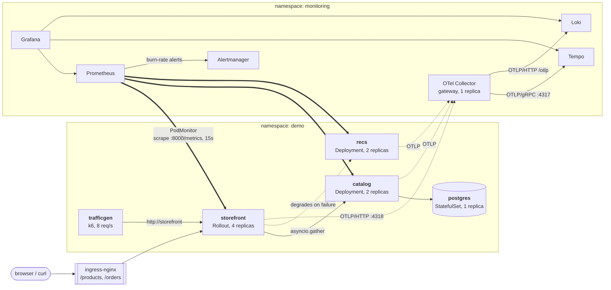
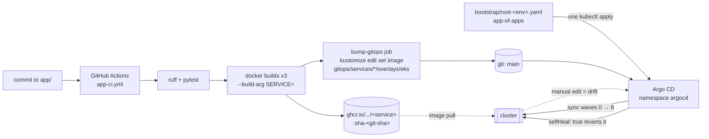

# Architecture

Three small HTTP services on Kubernetes, instrumented well enough that breaking them
produces measurable evidence. The application is scenery; the observability, delivery and
chaos machinery around it is the subject.

## Request flow

`storefront` is the only service behind the Ingress. `GET /products/{id}` fans out to
`catalog` and `recs` with `asyncio.gather`, so it costs the slower leg rather than the sum —
which is why storefront's 400ms latency threshold sits between catalog's 200ms and recs'
800ms.

The two dependencies fail differently, on purpose:

- **catalog failing is fatal to the request.** storefront turns it into a 503
  (`_upstream_error`), so both availability SLIs burn together.
- **recs failing is not.** storefront serves the product page with `recommendations: []` and
  `recommendations_degraded: true`, logs `serving without recommendations`, and its own SLI
  stays flat. This is the behaviour the `error-spike-recs` scenario exists to prove is real
  rather than a claim in a README.

storefront's `/readyz` reflects only catalog. Reporting NotReady because recs is down would
remove every pod from the Service and turn a partial degradation into a total outage.

`catalog` owns Postgres and is the only service whose readiness depends on something
external, which makes it where a database failure becomes visible first.

Load comes from a single k6 pod inside the cluster hitting the storefront Service directly
(not the Ingress — routing through ingress-nginx would fold the ingress controller's
availability into every SLI). Mix: 80% `GET /products`, 15% `GET /products/{id}`, 5%
`POST /orders`, at a constant arrival rate of 8 req/s.

## Runtime

Solid arrows are request paths, dotted arrows are telemetry pushed by the application, and
double arrows are Prometheus pulling. That distinction is the point of ADR 0002: traces and
logs are pushed through the collector, metrics are pulled per pod, and the reason is that
Argo Rollouts' canary analysis needs to tell canary pods from stable ones by the
`rollouts_pod_template_hash` pod label, which a gateway collector erases.

## GitOps flow

CI never touches a cluster. Its deploy step is a commit that pins an image tag in the EKS
overlays; Argo CD converges from there (ADR 0008). The `eks` overlays ship
`newTag: sha-placeholder`, a tag that deliberately does not resolve, so a rewrite that fails
to run produces `ImagePullBackOff` rather than a silent redeploy of `latest`.

`scripts/bootstrap.sh` installs Argo CD with Helm and applies one root Application. That is
the only imperative step in the system — a GitOps controller cannot bootstrap itself from a
repository it has not been told about. Everything after it is declarative, including the
child Applications, which `selfHeal` will recreate if deleted.

Argo CD syncs from `main` on GitHub, not from a working copy. Local edits under `gitops/`
do not reach the cluster until pushed. For application iteration, `make deploy-local`
builds, `kind load`s and restarts directly.

## Sync waves

The root app-of-apps expands into fourteen Applications ordered by
`argocd.argoproj.io/sync-wave`:

| Wave | Applications | Why here |
|---|---|---|
| 0 | kube-prometheus-stack, argo-rollouts | Establish the `PrometheusRule`/`PodMonitor` and `Rollout` CRDs before anything references them |
| 1 | ingress-nginx, chaos-mesh | Cluster-level plumbing, no dependencies on the app |
| 2 | loki, tempo | Trace and log backends must exist before the collector tries to export to them |
| 3 | otel-collector | Needs its exporters' targets |
| 4 | slo-rules, dashboards | Recording rules start evaluating before the first request is served, so the burn windows measure from t=0 |
| 5 | postgres | Database and its seed Job |
| 6 | catalog, recs | catalog blocks on `pg_isready` in an init container |
| 7 | storefront | Depends on both |
| 8 | trafficgen | Load starts once there is something to load |

`slo-rules` syncs `gitops/slo`, which is two directories: `generated/` (Sloth output,
overwritten by `make slo-gen`) and `handwritten/` (symptom alerts, edited by hand). Keeping
them under one Application means a burn-rate rule and the symptom rule that covers its blind
spot always arrive together. `specs/` is deliberately excluded — those are compiler input,
and no Sloth controller runs here to accept the CRD.

## Namespaces

| Namespace | Contents | Pod Security Admission |
|---|---|---|
| `demo` | storefront, catalog, recs, postgres, trafficgen | `enforce: baseline`, `warn`/`audit: restricted` |
| `monitoring` | Prometheus, Alertmanager, Grafana, kube-state-metrics, node-exporter, Loki, Tempo, OTel Collector | `enforce: privileged` — node-exporter needs `hostNetwork` and `hostPID` |
| `argocd` | Argo CD (Helm-installed, owns its own namespace) | not labelled here |
| `argo-rollouts` | Rollouts controller and dashboard | `enforce: baseline` |
| `chaos-mesh` | controller-manager, chaos-daemon, dns-server, dashboard | `enforce: privileged` — chaos-daemon mounts the containerd socket and enters other pods' network namespaces |
| `ingress-nginx` | controller | `enforce: privileged` — binds hostPort 80/443 on the kind control-plane node |

`gitops/bootstrap/namespaces.yaml` creates these explicitly even though every Application
carries `CreateNamespace=true`, because an auto-created namespace has no PSA labels — and
on a cluster that defaults to `restricted`, chaos-daemon and node-exporter would be
silently refused.

## Where each signal ends up

**Metrics.** In-process `prometheus_client` registry per app (`svc_common.metrics`, one
registry per instance so tests do not collide), exposed at `:8000/metrics` on the same port
as the API. A `PodMonitor` per service scrapes every 15s and copies
`rollouts-pod-template-hash`, `app.kubernetes.io/name` and `app.kubernetes.io/component`
off the pod onto the series. The metric names, labels and histogram buckets are fixed in
`docs/conventions.md`; the buckets contain every SLO threshold as an exact boundary.

**Traces.** OTel SDK with FastAPI and httpx instrumentation, OTLP/HTTP to
`otel-collector.monitoring:4318`, through the collector's traces pipeline
(`memory_limiter → k8sattributes → batch`) and out over OTLP/gRPC to
`tempo.monitoring:4317`. `/healthz`, `/readyz` and `/metrics` are excluded at the
instrumentor, or probe traffic would be roughly half the spans in Tempo. Each pod injects
`OTEL_RESOURCE_ATTRIBUTES=k8s.pod.name=...,k8s.namespace.name=...` from the downward API, so
a span can be traced back to the pod that served it.

**Logs.** Two sinks, from one root logger. `svc_common.logging` formats JSON to stdout —
one object per line, reserving `timestamp`, `level`, `service`, `message`, `trace_id` and
`span_id` — and `svc_common.logs.setup_log_export` attaches an OTel `LoggingHandler`
alongside it that exports the same records over OTLP/HTTP to
`{OTEL_EXPORTER_OTLP_ENDPOINT}/v1/logs`, through the collector's logs pipeline and on to
Loki at `/otlp/v1/logs`.

stdout is what survives: `kubectl logs` works when the collector is down, when Loki is
down, and in the first seconds of a pod's life. OTLP is what carries trace context, because
the handler reads `trace_id` off the active span rather than re-parsing it out of a JSON
string. Neither path raises if the backend is unreachable — a service that refuses to boot
because its logging pipeline is down is a worse outage than one running with degraded
observability.

The trade-off, stated rather than hidden: most clusters run a node-level agent tailing
container stdout instead, which also catches output from a process that dies before
flushing. Here a hard crash can lose its last exported lines. In Loki the service label
comes from the OTLP resource attribute `service.name` and arrives as `service_name`, so
queries start `{service_name="storefront"}` rather than with a Kubernetes label name.

uvicorn's own handlers are replaced so everything is JSON on one stream, and its access log
is silenced because the metrics middleware already records every request.

**Dependency metrics** cut across all three signals and are worth calling out separately.
`dependency_requests_total` and `dependency_request_duration_seconds` cover every outbound
call whatever the protocol: `storefront → catalog` and `storefront → recs` over HTTP,
`catalog → postgres` over SQL. One family for both means "catalog is slow because Postgres
is slow" reads the same way on a dashboard as "storefront is slow because recs is slow" —
and without the database timings, catalog's dashboard could only show total handler latency,
which cannot separate a slower query from a slower service.

## How the signals cross-link

**Log → trace.** Grafana's Loki datasource defines two derived fields: a label matcher on
`trace_id` (Loki lifts a log record's `TraceId` into structured metadata under that key when
it ingests OTLP — the path the `LoggingHandler` takes) and a regex fallback matching a
32-hex `trace_id` in a raw JSON body. Both produce a "View trace" link into Tempo by uid.

**Trace → log.** The Tempo datasource's `tracesToLogsV2` maps the `service.name` resource
attribute to Loki's `service_name` label, with a ±5 minute window and `filterByTraceID`.

**Metric → trace.** Prometheus runs with `--enable-feature=exemplar-storage` and Grafana's
Prometheus datasource declares `exemplarTraceIdDestinations` with
`traceIdLabelName: trace_id`. On the sending side, `svc_common.metrics.observe_request`
attaches `exemplar={"trace_id": ...}` to every latency observation made inside an active
span, and `/metrics` serves OpenMetrics when the scraper negotiates for it — exemplars do
not exist in the classic text format, so a service that ignored the `Accept` header would
look correct and never show a "View trace" button. A test pins the exemplar to the
exposition so a refactor cannot quietly drop it.

## Dashboards

Five, provisioned as ConfigMaps by `gitops/platform/dashboards/kustomization.yaml` and
picked up by the Grafana sidecar via `grafana_dashboard: "1"`:

| Title in Grafana | uid | File |
|---|---|---|
| storefront — service SLO | `slo-storefront` | `storefront.json` |
| catalog — service SLO | `slo-catalog` | `catalog.json` |
| recs — service SLO | `slo-recs` | `recs.json` |
| SLO overview — error budgets | `slo-overview` | `slo-overview.json` |
| Platform overview — cluster health | `platform-overview` | `platform-overview.json` |

`disableNameSuffixHash: true` keeps the
ConfigMap names stable, so editing a dashboard is an in-place update rather than a
create-plus-prune that would make it flicker out of Grafana mid-sync. `allowUiUpdates:
false` — dashboards are Git state.

## Reading the system in five minutes

1. `gitops/bootstrap/root-kind.yaml` — the one file `make bootstrap` applies. Everything
   else follows from it.
2. `gitops/clusters/kind/apps/` — fourteen Applications, one per component, ordered by sync
   wave.
3. `app/services/storefront/main.py` — 150 lines, and the fan-out plus the degrade branch is
   most of the interesting behaviour.
4. `gitops/slo/specs/storefront.yaml` — the SLO definitions and the reasoning for each
   target, and `gitops/slo/handwritten/symptom-rules.yaml` for the four alerts that cover
   what a budget cannot. `docs/slo-methodology.md` has the arithmetic behind both.
5. `chaos/scenarios.yaml` — nine hypotheses, each written before its run, with the
   inequality that sets every fault duration in the header.
6. `evidence/README.md` — the results.
